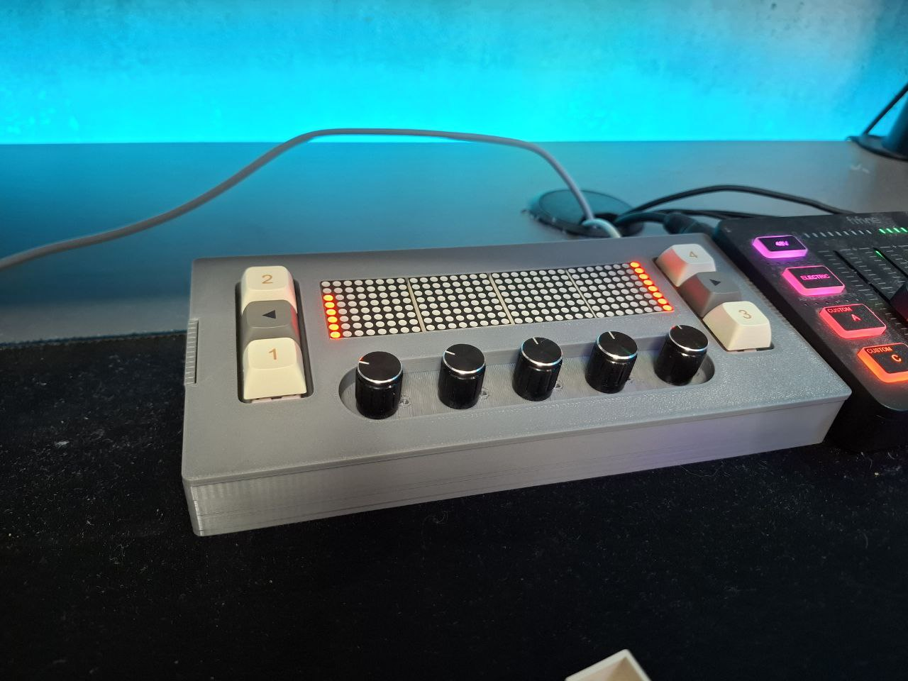
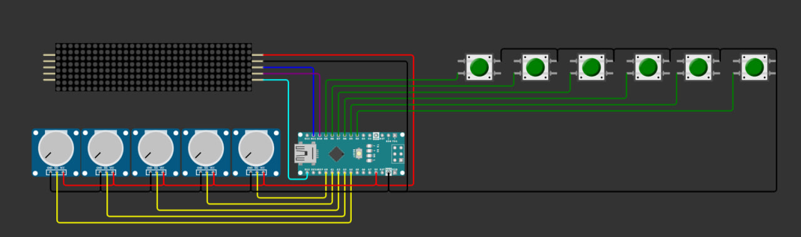

# deej-MAX7219

A fork of [omriharel deej](https://github.com/omriharel/deej) with additional features:

- ✅ **Support for push buttons** (from [Miodec deej](https://github.com/Miodec/deej))
- ✅ **MAX7219 LED matrix display support** (shows current potentiometers values)
- ✅ All original deej features preserved

  

## 💡 About

This project allows you to build a physical audio controller using Arduino-compatible boards.  
This fork extends the original deej with support for:

- Tactile buttons (e.g., to mute apps or run hotkeys)
- Visual display via MAX7219 matrix
- Full compatibility with Miodec's original deej logic

---

## 📦 Features

- 🎚️ Analog potentiometers to control application volumes
- ⬛ MAX7219 LED matrix shows real-time values
- 🔘 Customizable buttons for actions (mute, pause, etc.)

---

## ⚙️ Hardware Requirements

- Arduino 
- MAX7219 LED matrix
- Potentiometers or linear sliders
- Optional: push buttons
- Optional: capacitors for voltage stability

---

## 🔌 Wiring Notes

- Potentiometers: Connect to analog pins
- Buttons: Connect to digital pins 
- MAX7219: Connect via SPI

---

## 🧠 Software Setup

1. Flash the Arduino code from this repo (see `arduino/` folder).
2. Download and run the desktop client (`deej.exe` from [Miodec releases](https://github.com/Miodec/deej/releases/tag/compile)).
3. Configure `config.yaml` as in original deej.
4. Enjoy physical control over your system audio!

---

## 👤 Credits

- Original project: [omriharel](https://github.com/omriharel/deej)
- Button support: [Miodec](https://github.com/Miodec/deej)
- MAX7219 integration & this fork: [Figeiron](https://github.com/Figeiron)

## 📄 License

This project follows the original [MIT License](https://github.com/omriharel/deej/blob/master/LICENSE).

